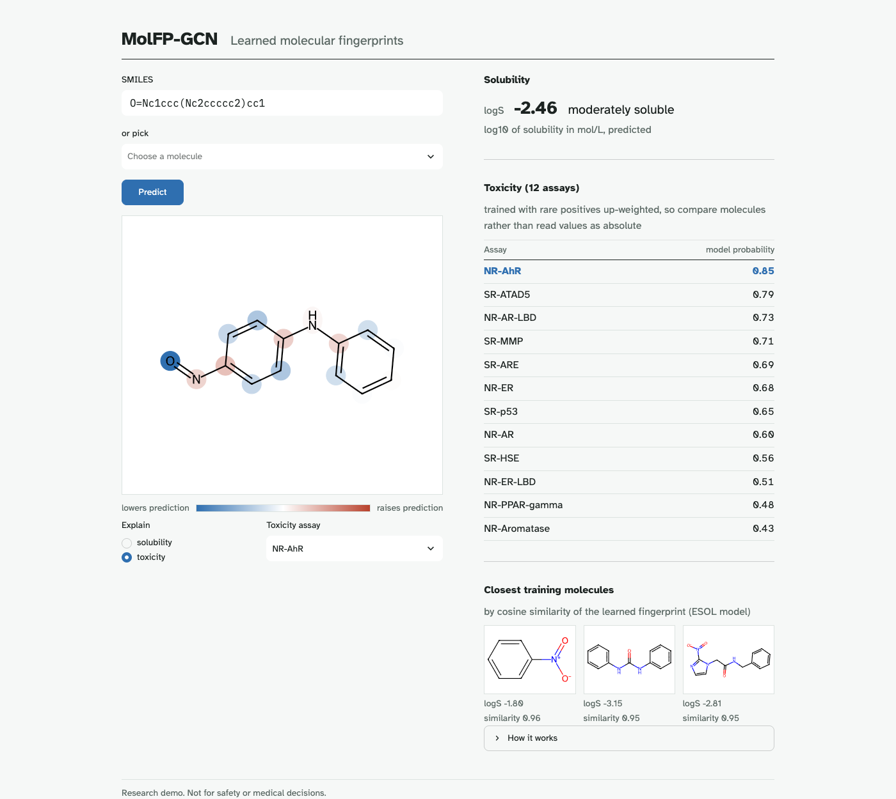

# MolFP-GCN

| Name | Roll no. |
|---|---|
| Gurram Naga Kumaraswamy | S20230010101 |
| Simon Peter | S20230010171 |
| Rakesh | S20230010196 |

Course: `<COURSE NAME AND CODE>`

A fixed fingerprint like ECFP describes a molecule the same way whatever you want to predict.
This project trains a graph convolutional network that learns its own fingerprint instead,
with atoms as nodes and bonds as edges, and compares it with ECFP + random forest on the same
scaffold splits. We used two MoleculeNet tasks: ESOL solubility (regression) and Tox21 (12
toxicity assays). The GCN came out ahead on both, though the ESOL margin depends a lot on
which scaffolds end up in the test set (see the report). A small Streamlit app draws a
molecule, predicts both properties, and colours the atoms that pushed each prediction up or
down.



## Results

Test set, Bemis–Murcko scaffold split, mean ± std over seeds 0, 1, 2. This table is written
by `python -m molfp.figures` from `results/*.json`.

<!-- results:start -->
| Model | ESOL RMSE ↓ | ESOL MAE ↓ | ESOL R² ↑ | Tox21 mean ROC-AUC ↑ |
|---|---|---|---|---|
| GCN (learned fingerprint) | 1.063 ± 0.163 | 0.856 ± 0.124 | 0.709 ± 0.048 | 0.811 ± 0.009 |
| ECFP4 + random forest | 1.694 ± 0.498 | 1.287 ± 0.378 | 0.267 ± 0.248 | 0.756 ± 0.015 |
<!-- results:end -->

New to the project? Start with [docs/PROJECT_IN_SIMPLE_WORDS.md](docs/PROJECT_IN_SIMPLE_WORDS.md).
Full write-up: [reports/REPORT.md](reports/REPORT.md). Viva notes: [docs/EXPLAIN.md](docs/EXPLAIN.md).

## Reproduce

Needs [uv](https://docs.astral.sh/uv/). `make all` took 11 min on an Apple M2 CPU from a fresh clone
(plus package download time on first install), and reproduced every committed result byte for byte.

```
make all          # install, download, train 3 seeds x 2 models x 2 datasets, evaluate, figures, tests
make ablations    # ESOL depth / readout / split ablations (then `make figures` again)
make demo         # open the app at http://localhost:8501
```

Individual steps: `make setup`, `make data`, `make train`, `make eval`, `make figures`,
`make test`, `make lint`. One run: `python -m molfp.train --config configs/esol_gcn.yaml --seed 0`.

The app also takes a link: `http://localhost:8501/?smiles=CCO`.

## Layout

```
molfp/        featurize, data, split, model, baseline, train, evaluate, explain, figures,
              metrics, invariants (the 12 rules and where each is enforced)
configs/      esol_gcn.yaml, tox21_gcn.yaml, esol_ablations.yaml
scripts/      download_data.py, pick_tox21_preset.py
app/          streamlit_app.py, style.css, vendored fonts
tests/        pytest suite, one file per module
data/         CHECKSUMS.txt and splits/ are committed; raw CSVs are downloaded
results/      esol.json, tox21.json, ablations.json
reports/      REPORT.md (generated from REPORT.src.md), figures/
docs/         PROJECT_IN_SIMPLE_WORDS.md, ARCHITECTURE.md, adr/, EXPLAIN.md, DESIGN.md
```

## Known limitations

- **GCNConv ignores bond types.** Bond order, conjugation and ring membership are stored in
  `edge_attr`, but GCNConv only passes atom features along edges, so C=O and C–O look the
  same to it. An edge-aware layer (GINE, GATv2 with `edge_dim`, D-MPNN) is the natural next
  step; see [ADR 001](docs/adr/001-gcn-over-gat-mpnn.md).
- ESOL has about 1,100 molecules, so seed-to-seed spread is large.
- Tox21 probabilities are not calibrated (rare positives are up-weighted in training).
- The Tox21 scaffold split here is likely easier than DeepChem's deterministic one, so the
  numbers aren't directly comparable with published results.

Research demo only. Not for safety or medical decisions. MIT licence.
