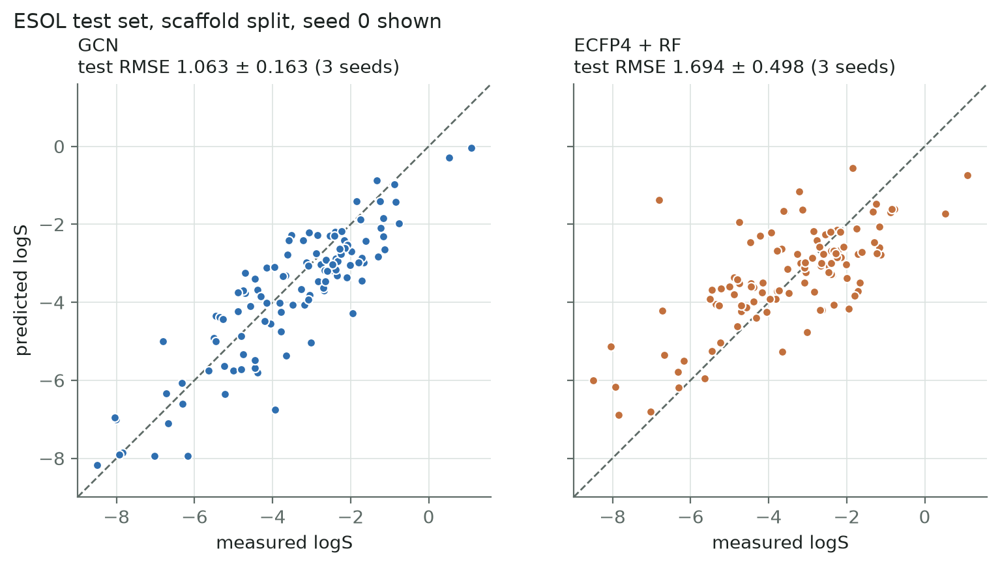
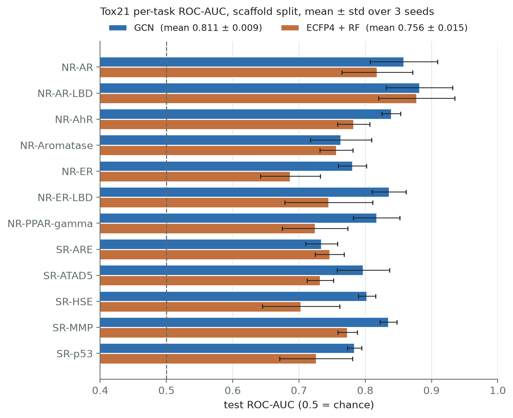
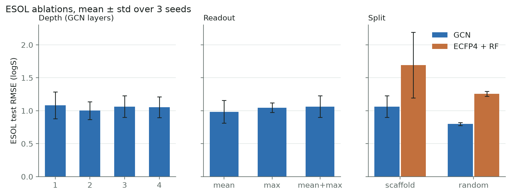
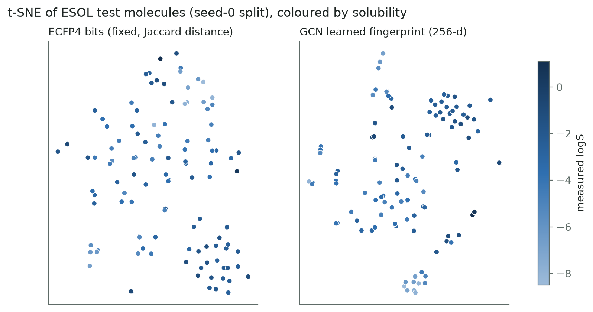
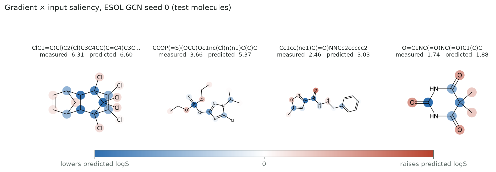

# Learned molecular fingerprints with a graph convolutional network

**Gurram Naga Kumaraswamy** · Roll no. `<ROLL NO>` · `<COURSE NAME AND CODE>` · 2026

All numbers in this report are filled in by `python -m molfp.figures` from `results/*.json`.
None are typed by hand. Every result is the mean ± sample standard deviation over seeds
0, 1 and 2, where the seed changes both the scaffold split and the model initialisation.

## 1. Introduction

A molecular fingerprint turns a molecule into a fixed-length vector that a standard model can
use. The usual choice is ECFP (a Morgan fingerprint): each atom's neighbourhood, up to some
radius, is hashed into one of 2048 bits. The hash is fixed. Aspirin gets the same bits
whether the question is solubility or liver toxicity.

A graph convolutional network (GCN) does something similar but learns it. Atoms are nodes,
bonds are edges, and each layer lets an atom mix in information from its bonded neighbours.
After a few layers the atom vectors are pooled into one molecule vector, and the whole thing
is trained end to end, so the "fingerprint" ends up shaped by the task. Duvenaud et al. (2015)
called this a differentiable fingerprint.

I wanted to test two things on public data. First, does the learned fingerprint actually beat
ECFP + random forest when both get the same molecules and the same honest split? Second, can
the model point at the atoms behind a prediction?

## 2. Data

| Dataset | Task | Molecules used | Test molecules (seed 0) |
|---|---|---|---|
| ESOL (Delaney) | log solubility in mol/L, regression | {{esol_n}} | {{esol_test_n}} |
| Tox21 | 12 toxicity assays, binary, labels partly missing | {{tox21_n}} | {{tox21_test_n}} |

Both come from the DeepChem mirror. Their SHA-256 hashes are in `data/CHECKSUMS.txt`, and
the download script refuses to continue if a file changes. RDKit cannot sanitise
{{tox21_dropped}} of the Tox21 SMILES, so they are dropped with a logged count; ESOL loses {{esol_dropped}}. {{tox_missing_pct}} of Tox21
labels are missing. They are masked out of the loss and out of every ROC-AUC, never filled with 0.

**Split.** Molecules are grouped by Bemis–Murcko scaffold (the ring systems and the linkers
between them) and whole groups are assigned to train, validation or test in an 80/10/10
ratio, so no scaffold appears in more than one set. Scaffold groups bigger than half the test
size go to train first; the rest are shuffled with the seed. The index files live in
`data/splits/` and both models read the same file. A test checks that the GCN and the random
forest follow even a deliberately altered split file. Another checks that no molecule
(compared as canonical SMILES) sits in both train and test.

## 3. Method

**Featurisation.** Each atom is a 35-number vector: one-hot element (C, N, O, S, F, Cl, Br, I,
P, other), degree, formal charge, hydrogen count, hybridisation, plus aromatic and in-ring
flags and mass/100. Each bond becomes two directed edges. Hydrogens are counted as an atom
feature rather than added as nodes. Bond types are stored but the GCN does not use them
(see Limitations).

**Model.** A linear layer maps atoms to 128 dimensions. Three GCNConv layers follow, each with
batch norm, ReLU and dropout 0.2, and residual connections from the second layer on. One
GCNConv layer computes

  H′ = D^−½ (A + I) D^−½ H W

which means each atom takes a degree-normalised average of itself and its neighbours and then
applies a shared linear map. Mean pooling and max pooling over atoms are concatenated into a
256-d vector. This is the learned fingerprint. A two-layer MLP maps it to one output (logS)
or twelve logits. Mean and max do not depend on atom order, and a test confirms that
renumbering the atoms changes the output by less than 1e-5.

**Baseline.** ECFP4 (Morgan radius 2, 2048 bits) with a 500-tree random forest. For Tox21
there is one forest per assay, trained only on the molecules labelled for that assay.

**Training.** Adam (lr 1e-3, weight decay 1e-5), batch 64, up to 300 epochs, early stopping
with patience 30 on the validation metric (RMSE for ESOL, mean ROC-AUC for Tox21). ESOL
targets are standardised with the training-set mean and standard deviation only. Tox21 uses
masked binary cross-entropy with a per-assay positive weight (negatives/positives in the
training set), because only {{tox_pos_pct}} of labels are positive. The test set is scored once,
after training, by `molfp.evaluate`. As a check on that claim, one test scrambles the
features and labels of every test molecule, retrains, and asserts that the weights come out
bit-identical.

## 4. Results

{{table_main}}

The GCN has the lower error on ESOL and the higher ROC-AUC on Tox21. On Tox21 the gap is
larger than the seed-to-seed spread. The GCN is ahead on {{tox_gcn_task_wins}} of the 12
assays; the forest is ahead on {{tox_rf_task_wins}}.

The ESOL comparison needs a caveat. The random forest's standard deviation is very large, and
the per-seed numbers show why:

{{table_per_seed}}

In seed 1 the whole biphenyl scaffold group, which includes the polychlorinated biphenyls, fell
into the test set. These are the least soluble molecules in ESOL (logS down to {{esol_min_logs_s1}}).
A random forest predicts by averaging training targets, so it cannot go below the range it
was trained on. ECFP also only records that a chlorine environment is present, not how many
there are. For the least soluble test molecule the forest predicted {{pcb_rf_pred}} and the GCN
{{pcb_gcn_pred}}. The forest's RMSE for that seed is {{esol_rf_rmse_s1}}. The GCN got {{esol_gcn_rmse_s1}} on the same split. It
sees atom counts through mean pooling and the mass feature, and its linear head can
extrapolate a little. On seeds 0 and 2, which are more typical, the forest scores
{{esol_rf_rmse_s0}} and {{esol_rf_rmse_s2}} against the GCN's {{esol_gcn_rmse_s0}} and
{{esol_gcn_rmse_s2}}. So the GCN still wins, but by less than the headline mean suggests.



Two results fall outside the sanity bands I set before training. The ESOL forest (RMSE
{{esol_rf_rmse}}) is above the expected 0.9–1.4, for the reason above. The Tox21 GCN (ROC-AUC
{{tox_gcn_auc}}) is slightly above the expected 0.68–0.80. I checked for duplicates between
train and test and found none. My best explanation is the split variant. DeepChem's
deterministic scaffold split sends the rarest scaffolds to test, while this one sends the
large groups to train and samples the test set from the remaining small groups at random.
That is likely an easier test set than the one behind most published Tox21 scaffold numbers,
so these numbers should not be compared directly with papers.



{{table_tox21}}

Training curves are in `figures/training_curves.png`. Validation RMSE on ESOL is noisy from
epoch to epoch (the seed-0 validation set has {{esol_val_n}} molecules), and the best epochs were
{{esol_gcn_epochs}}. Tox21 validation AUC is smoother, with best epochs {{tox_gcn_epochs}}.

## 5. Ablations (ESOL)



{{table_ablations}}

**Depth.** One to four layers give {{abl_depth_1}}, {{abl_depth_2}}, {{abl_depth_3}} and
{{abl_depth_4}}. Every difference is well inside one standard deviation. I can't claim that
three layers is best, or that depth matters at all at this dataset size. I expected
over-smoothing to hurt at four layers and did not see it, possibly because of the residual
connections.

**Readout.** Mean, max and mean+max give {{abl_readout_mean}}, {{abl_readout_max}} and
{{abl_readout_meanmax}}. Again no clear winner. I kept mean+max because it was the planned
default, not because the ablation favoured it.

**Split.** This is the one clear effect. With a random split the GCN reaches
{{abl_split_random}} and the forest {{abl_split_random_rf}}, against {{abl_split_scaffold}}
and {{abl_split_scaffold_rf}} under the scaffold split. A random split puts close analogues of
test molecules in the training set, and both models look better than they are. This is the
reason every headline number here uses the scaffold split.

## 6. What the fingerprint learned



The t-SNE plots show the ESOL test molecules under each representation, coloured by measured
solubility. ECFP groups molecules by shared substructures, and solubility is mixed within its
clusters. In the learned fingerprint the least soluble molecules form their own group and the
colour changes more smoothly across the map. t-SNE distorts distances and depends on its
random seed, so I read this as a picture that agrees with the numbers, not as evidence on its
own.

**Saliency.** For a prediction *o* and atom features *X*, each atom gets the score
Σ_f X[i,f] · ∂o/∂X[i,f] (gradient × input), scaled to [−1, 1]. Red atoms push the prediction
up and blue atoms push it down.



On ESOL the maps are mostly chemically sensible. Carbonyl and hydroxyl oxygens raise predicted
solubility, while aromatic and chlorinated carbon cores lower it. The maps have limits. A
gradient describes a tiny change to the features, not what happens if an atom is removed.
Message passing also spreads credit onto neighbours, so a highlighted carbon may be
highlighted because of the oxygen next to it. I treat saliency as a hint about what the model
used, not as a chemical explanation.

## 7. Limitations

- GCNConv ignores bond order and aromaticity of bonds. A C=O and a C–O send identical
  messages. The bond features are already stored in `edge_attr`, so an edge-aware layer could
  use them directly.
- ESOL is small. With {{esol_test_n}} test molecules, one scaffold group can move the RMSE by more
  than the difference between models, as seed 1 shows.
- Hyperparameters were fixed in advance and not tuned for either model. A tuned forest (or
  one with count-based fingerprints) would probably close some of the ESOL gap.
- Tox21 probabilities are not calibrated. The positive weighting inflates them, so the demo
  shows them for ranking molecules, not as absolute risk.
- Three seeds give a rough error bar, not a significance test.

## 8. Future work

- Replace GCNConv with an edge-aware layer (GINE, GATv2 with `edge_dim`, or a D-MPNN) and
  check whether bond information closes the remaining ESOL errors on conjugated systems.
- Compare against the deterministic DeepChem scaffold split as well, so the Tox21 numbers can
  be placed next to published ones.
- Test the saliency maps with a deletion check: mask the top-k atoms and measure how much the
  prediction moves compared with masking random atoms.

## Reproducing

```
make setup data train eval figures test    # main results, CPU
make ablations && make figures             # ablations and their figures
make demo                                  # the Streamlit app
```

## References

- Delaney, J. S. (2004). ESOL: estimating aqueous solubility directly from molecular structure. *J. Chem. Inf. Comput. Sci.* 44(3).
- Duvenaud, D. et al. (2015). Convolutional networks on graphs for learning molecular fingerprints. *NeurIPS*.
- Kipf, T. N. & Welling, M. (2017). Semi-supervised classification with graph convolutional networks. *ICLR*.
- Rogers, D. & Hahn, M. (2010). Extended-connectivity fingerprints. *J. Chem. Inf. Model.* 50(5).
- Wu, Z. et al. (2018). MoleculeNet: a benchmark for molecular machine learning. *Chemical Science* 9.
- Bemis, G. W. & Murcko, M. A. (1996). The properties of known drugs. 1. Molecular frameworks. *J. Med. Chem.* 39(15).
